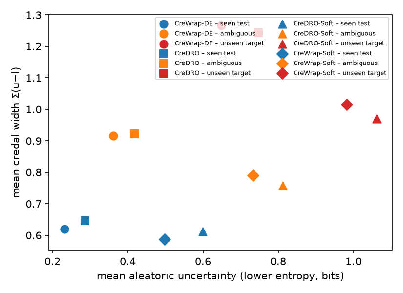

# Credal Uncertainty Quantification for Reliable Stance Detection on Unseen Targets

Stance detection assigns FAVOR, AGAINST or NONE to a (text, target) pair. A single softmax vector cannot tell **ambiguity** (humans disagree about the text) from **ignorance** (the model has never seen the target). This project replaces the probability vector with a **credal set**, a box of lower and upper class probabilities, so that the set's *location* reflects ambiguity and its *size* reflects ignorance.

Six credal constructions are compared on one DeBERTa-v3-base backbone, and a new combination is proposed: **CreDRO-Soft**, distributionally-robust ensemble members trained on human label distributions recovered from the publicly released SemEval-2016 per-annotator votes. No new annotation is collected.

- **Full report:** [FINAL_REPORT.md](FINAL_REPORT.md) (problem definition, alternatives, architecture, protocol, results, discussion, references)
- **LaTeX version:** [CrediStance_Final_Report.tex](CrediStance_Final_Report.tex), Overleaf bundle [CrediStance_Final_Report_overleaf.zip](CrediStance_Final_Report_overleaf.zip)
- **Code walkthrough:** [IMPLEMENTATION.md](IMPLEMENTATION.md)
- **Generated tables:** [results/tables.md](results/tables.md), [results/ablation_stats.md](results/ablation_stats.md)

## Methods compared

| Family | Method | Members | Training target |
|---|---|---|---|
| Baselines | Softmax, Temperature scaling, MC-dropout (MI), Deep ensemble (MI), Evidential DL | 1 / 5 | hard labels |
| Credal wrapper | CreWrap-DE, MCD-Credal, CreWrap-Soft | 5 | hard / human label distribution |
| Interval heads | CreDE (Credal Deep Ensembles) | 5 | hard labels |
| Robust members | CreDRO, **CreDRO-Soft (proposed)** | 5 | hard / human label distribution, CVaR-DRO loss |
| Single model | EffCre (likelihood decalibration) | 1 | hard labels |
| LLM | Prompt-paraphrase credal set, Qwen2.5-3B-Instruct, zero-shot | 8 prompts | none |

## Headline results

SemEval-2016 in-target test (n = 1,249), five leave-one-target-out (LOTO) folds, P-Stance and COVID-19 as cross-dataset unseen targets.

| Metric | Softmax | Deep ensemble | CreDRO-Soft |
|---|---|---|---|
| Accuracy | 0.74 | 0.76 | 0.75 |
| ECE (lower is better) | 0.154 | 0.086 | 0.041 |
| Unseen-target AUROC, LOTO mean ± std (upper entropy) | 0.816 ± 0.065 | 0.875 ± 0.037 | 0.905 ± 0.021 |
| Folds where it beats softmax | – | 3/5 | 5/5 (p = 0.025) |

Other findings reported in the paper:

- Soft-label credal models keep the epistemic score flat on 1,101 human-contested tweets while the aleatoric score rises. Hard-label models do not.
- Conformal credal sets reach the nominal 90 % / 80 % coverage of the human label distribution for every method. Soft-label training gives the tightest sets.
- Set-valued answers cut expected decision cost by about 25 % in-target and 30 to 50 % on unseen targets, without deferral.
- The textbook epistemic score (upper minus lower entropy) **fails** on unseen targets (AUROC 0.34) because the lower entropy saturates. Interval width or upper entropy should be used instead.
- In-target selective prediction is *not* improved. Softmax entropy remains the best in-distribution error detector.
- A single soft-label DRO model already beats a 5-member hard-label ensemble on calibration and novelty detection. Going from 5 to 8 members brings no further gain.



## Repository layout

```
credistance/
  prepare_data.py      build data/processed/*.jsonl with human label distributions
  train.py             one ensemble member: ce | soft | dro | softdro | crenet | edl
  credal.py            NumPy credal core: bounds, entropies, decomposition, conformal, metrics
  make_jobs.py         writes the training job grid (jobs*.txt)
  run_jobs.sh          runs jobs in parallel on the GPU, skips finished ones
  llm_prompt_credal.py prompt-paraphrase credal sets from an instruction-tuned LLM
  analysis.py          experiments E1 to E7 -> results/tables.md, results/results.json, figures
  ablation_stats.py    ensemble-size ablation, bootstrap CIs, paired fold tests
data/                  raw SemEval / P-Stance / COVID-19 files, raw annotator votes, processed JSONL
datasets/              original downloaded archives
runs/                  cached member outputs (logits, interval bounds) for every trained model
results/               tables, results.json, figures
```

## Reproducing

Requirements: Python 3.11+, PyTorch with CUDA, `transformers>=5`, `peft`, `scipy`, `matplotlib`, `scikit-learn`. One 48 GB GPU was used; 24 GB is sufficient with fewer parallel jobs.

```bash
python credistance/prepare_data.py                      # data/processed/*.jsonl
python credistance/make_jobs.py                         # jobs.txt, jobs_loto.txt, jobs_m8.txt
bash credistance/run_jobs.sh 3 jobs.txt                 # 3 parallel members; repeat for jobs_loto.txt
python credistance/llm_prompt_credal.py --model Qwen/Qwen2.5-3B-Instruct --out runs/llm_qwen3b
python credistance/analysis.py                          # results/tables.md + figures
python credistance/ablation_stats.py                    # results/ablation_stats.md
```

The cached outputs in `runs/` let the last two commands reproduce every table without retraining.

Note for `transformers>=5`: DeBERTa-v3 checkpoints load in fp16 by default, which makes fine-tuning diverge. `train.py` forces `dtype=torch.float32`.

## Data

- SemEval-2016 Task 6 (Mohammad et al., 2016) train and test gold files, plus the released raw per-annotator votes used to build human label distributions.
- P-Stance (Li et al., 2021) and COVID-19-Stance (Glandt et al., 2021) test sets as cross-dataset unseen targets.
- 1,385 low-agreement tweets dropped from the original shared task, used as an ambiguity stress test.

See the full report for citations and the LaTeX file for the bibliography.
